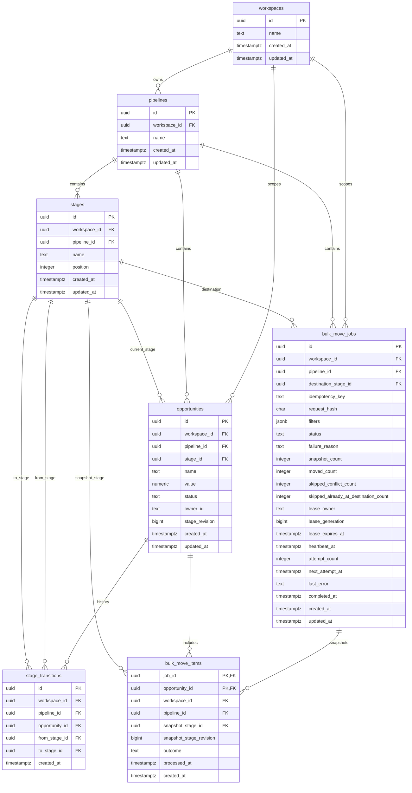

# Bulk Stage Move Design

## 1. Overview

The service provides tenant- and pipeline-scoped opportunity operations and a
durable bulk stage-move job. The HTTP API and the background worker are separate
NestJS processes. PostgreSQL stores the opportunities, snapshot membership and
captured stage revisions, per-item outcomes, leases, and progress; no external
queue or broker is used.

The request's `X-Workspace-Id` header selects workspace context; it is not
authentication. Services also scope queries by `pipelineId`, and database
composite foreign keys prevent records from crossing workspace/pipeline
boundaries.

## 2. High-level architecture

```mermaid
flowchart LR
    Client[Client]

    subgraph APIProcess["NestJS API process"]
        Middleware["Workspace middleware<br/>UUID validation and workspace context"]
        Controllers["Opportunity and bulk-move controllers<br/>HTTP routes and path validation"]
        Services["Opportunity and bulk-move services<br/>Body/filter validation and scoped operations"]
        Middleware --> Controllers --> Services
    end

    subgraph WorkerProcess["Separate NestJS worker process"]
        Worker["BulkMoveWorker<br/>poll, claim, lease, retry"]
        Chunk["Chunk transaction<br/>lock and compare opportunity revision<br/>write transition and item outcome"]
        Worker -.-> Chunk
    end

    DB[("PostgreSQL<br/>workspaces, pipelines, stages,<br/>opportunities, transitions,<br/>bulk jobs and items")]

    Client -->|"HTTP request"| Middleware
    Services -->|"Synchronous SQL<br/>including submit and snapshot transaction"| DB
    DB -->|"Query results and persisted progress"| Services
    Controllers -->|"HTTP response<br/>including accepted job handle or progress"| Client
    Worker -.->|"Poll and claim eligible job"| DB
    DB -.->|"Persisted job and pending items"| Worker
    Chunk -.->|"Commit opportunity update,<br/>transition, item outcome and counters"| DB

    linkStyle 0,1,3,4,5,6 stroke:#2563eb,stroke-width:2px;
    linkStyle 2,7,8,9 stroke:#7c3aed,stroke-width:2px,stroke-dasharray:5 5;
```

Solid arrows denote synchronous API/SQL interactions; dashed arrows denote
worker polling and background commits. The API handles interactive requests
and creates the job plus its snapshot within a database transaction before
returning `202 Accepted`. The worker is separate so long-running bulk work does
not occupy the API request path; it polls PostgreSQL for eligible work and
processes persisted items in bounded chunks. PostgreSQL is the durable
coordination mechanism: restarting either process does not lose job state,
item outcomes, lease state, or committed progress. Each chunk commits
opportunity changes, transition history, item outcomes, and job counters
together.

Compose's `initialize` service applies migrations and the small seed before the
API and worker start. The API uses Sequelize with a default maximum pool size of
nine connections; its health-readiness check uses a separate one-connection
`pg` pool. The worker uses Sequelize and defaults to a two-connection pool.
Both processes are configured to connect to the same PostgreSQL database.

## 3. Database schema

The following ER diagram reflects the foreign keys in the core-schema
migration. `(FK)` marks a column participating in an enforced foreign key.
When multiple columns carry the marker for one relationship, they form a
composite foreign key rather than separate direct references.

Workspaces own pipelines; stages and opportunities belong to a pipeline, and a
current opportunity stage must belong to that same workspace and pipeline.
Stage transitions retain the opportunity and both stage IDs, providing movement
history. A bulk job stores the request and its snapshot count; one item per
opportunity records snapshot stage/revision and the terminal or pending
outcome.

The direct single-column foreign keys are `pipelines.workspace_id`,
`opportunities.workspace_id`, and `bulk_move_jobs.workspace_id`, each
referencing `workspaces.id`. Composite foreign keys map these columns in the
listed order:

- `stages(workspace_id, pipeline_id)` to `pipelines(workspace_id, id)`.
- `opportunities(workspace_id, pipeline_id)` to
  `pipelines(workspace_id, id)`, and
  `opportunities(workspace_id, pipeline_id, stage_id)` to
  `stages(workspace_id, pipeline_id, id)`.
- `stage_transitions(workspace_id, pipeline_id, opportunity_id)` to
  `opportunities(workspace_id, pipeline_id, id)`;
  `stage_transitions(workspace_id, pipeline_id, from_stage_id)` and
  `stage_transitions(workspace_id, pipeline_id, to_stage_id)` each reference
  `stages(workspace_id, pipeline_id, id)`.
- `bulk_move_jobs(workspace_id, pipeline_id)` to
  `pipelines(workspace_id, id)`, and
  `bulk_move_jobs(workspace_id, pipeline_id, destination_stage_id)` to
  `stages(workspace_id, pipeline_id, id)`.
- `bulk_move_items(workspace_id, pipeline_id, job_id)` to
  `bulk_move_jobs(workspace_id, pipeline_id, id)`;
  `bulk_move_items(workspace_id, pipeline_id, opportunity_id)` to
  `opportunities(workspace_id, pipeline_id, id)`; and
  `bulk_move_items(workspace_id, pipeline_id, snapshot_stage_id)` to
  `stages(workspace_id, pipeline_id, id)`.

Thus `stage_transitions` and `bulk_move_items` have no standalone workspace or
pipeline foreign key; those columns participate only in the composite
references. The Sequelize models mirror the columns but do not declare
association decorators; the migration is the source of enforced relationships.

Nullable job columns are `failure_reason`, `lease_owner`, `lease_expires_at`,
`heartbeat_at`, `next_attempt_at`, `last_error`, and `completed_at`;
`bulk_move_items.processed_at` is also nullable. Other columns are `NOT NULL`.
The diagram abbreviates `numeric(18,2)` as `numeric` and `char(64)` as `char`.

Important uniqueness and coordination constraints are:

- Pipelines: `(workspace_id, id)`.
- Stages: `(workspace_id, id)`, `(workspace_id, pipeline_id, id)`, and unique
  position within `(workspace_id, pipeline_id)`.
- Opportunities: `(workspace_id, id)` and
  `(workspace_id, pipeline_id, id)`.
- Jobs: `(workspace_id, idempotency_key)` and
  `(workspace_id, pipeline_id, id)`. A partial unique index on
  `bulk_move_jobs(workspace_id) WHERE status = 'running'` permits at most one
  running bulk job per workspace.
- Items: primary key `(job_id, opportunity_id)`, preventing duplicate
  membership for one opportunity in a job.

Query/coordination indexes include the opportunity stage-list index on
`(workspace_id, pipeline_id, stage_id, created_at, id)`, the job-claim index on
`(status, next_attempt_at, created_at)`, and the pending-item index on
`(job_id, outcome, opportunity_id)`.

## 4. API and submission

The opportunity routes are:

- `POST /pipelines/:pipelineId/opportunities` creates an opportunity.
- `PATCH /pipelines/:pipelineId/opportunities/:opportunityId/stage` moves one
  opportunity.
- `GET /pipelines/:pipelineId/opportunities` lists a stage using `stageId`, a
  page size up to 100, and a stable `(created_at, id)` cursor.

Bulk routes are `POST /pipelines/:pipelineId/opportunity-bulk-moves` to submit a
job and `GET /pipelines/:pipelineId/opportunity-bulk-moves/:jobId` to get
progress. All routes require a valid `X-Workspace-Id` UUID; controllers
validate path UUIDs and services query with workspace and pipeline scope.

Submission requires an `Idempotency-Key` and a destination stage. Optional
filters combine stage, owner, status, inclusive minimum/maximum value, inclusive
`createdFrom`, and exclusive `createdTo`. The service normalizes the request and
rejects a source `stageId` equal to `destinationStageId`. It hashes the
workspace, pipeline, destination, and normalized filters with SHA-256.

In one PostgreSQL transaction, submission looks up the key, inserts the job
using `ON CONFLICT (workspace_id, idempotency_key) DO NOTHING`, snapshots
matching opportunity IDs with their current stage and stage revision, and saves
the resulting snapshot count. The snapshot query is scoped to workspace and
pipeline and caps insertion at 50,001 to reject more than 50,000 matches; a
rejection rolls back the transaction. An identical retry returns the existing
job; reuse of a key with a different normalized request returns `422`. The
unique constraint resolves simultaneous same-key submissions. The key is
workspace-scoped; the request hash also binds it to the pipeline.

Membership is a submission-time snapshot, not a live query. Later changes to
filter fields do not add or remove items. The snapshot records opportunity ID,
stage ID, and stage revision—not a historical copy of every opportunity field.

## 5. Worker, concurrency, and recovery

The worker polls at the configured interval and claims one eligible job at a
time using a transaction and `FOR UPDATE SKIP LOCKED`. Eligible jobs are
queued, retryable after `next_attempt_at`, or running with an expired lease.
Claiming sets a unique worker ID, increments the lease generation, records a
database-clock expiry and heartbeat, and persists the attempt state.

For each chunk, the worker locks the job and workspace, verifies that its lease
owner and generation are current and unexpired, then selects pending items in
opportunity-ID order. It locks opportunity rows with `FOR UPDATE ... SKIP
LOCKED` and processes at most `BULK_MOVE_CHUNK_SIZE` items. If all pending rows
are temporarily locked, the worker waits and retries rather than completing
the job. Chunk changes and counters commit atomically. The chunk pause yields
between chunks; the worker runs as a separate process and uses a small
PostgreSQL pool. Defaults are 100 items per chunk, a 50 ms inter-chunk pause,
500 ms polling, a 30-second lease, and eight attempts. Compose caps the worker
pool at two connections. One worker processes one claimed job at a time; the
database's one-running-job-per-workspace index caps same-workspace bulk
concurrency even if multiple workers are started.

Each snapshot item is handled as follows:

- If the opportunity is already in the destination stage, record
  `skipped_already_at_destination`.
- If its current stage or `stage_revision` differs from the snapshot, record
  `skipped_conflict` and preserve the current opportunity state.
- Otherwise, update the stage with a conditional workspace/pipeline/ID/stage/
  revision predicate, increment `stage_revision`, insert a transition, and
  mark the item `moved`.

A manual move locks the opportunity row, validates the destination within the
same workspace and pipeline, increments `stage_revision`, and writes the
transition in the same transaction. Thus manual and bulk writes serialize on
the opportunity row. If the manual edit wins first, the bulk item detects the
stage or revision change and records a conflict unless the opportunity is now
at the bulk destination, which is recorded as
`skipped_already_at_destination`. A manual move away and back to the snapshot
stage still conflicts because the revision changed. If the worker wins first,
the manual move applies after it and records its own transition. A manual move
to the current stage is a no-op and creates no transition.

The lease is renewed after each chunk and while waiting on locked rows. Lease
generation fences an old worker: a stale owner cannot commit a chunk after a
new claim. A process crash leaves committed terminal item outcomes intact;
after lease expiration another worker reclaims the job and selects only
`pending` items. Opportunity update, transition, item outcome, and counter
updates are in the same transaction, so a crash cannot persist only part of a
chunk.

Caught processing errors move the job to `retry_wait` with bounded
exponential backoff and jitter, or to `failed` when the attempt budget is
exhausted. An expired lease is likewise reclaimable until the maximum attempt
count is reached. The explicit `npm run jobs:resume -- --job-id <uuid>` command
requeues a failed job, preserving terminal item outcomes and counters while
resetting its attempt state.

## 6. Progress and guarantees

Progress is read from the persisted job row, not an in-memory counter.
`snapshot_count`, `moved_count`, `skipped_conflict_count`, and
`skipped_already_at_destination_count` are committed with item outcomes.
`pendingCount` is derived as snapshot count minus the three terminal outcome
counts. The response includes status, last heartbeat, last error, failure
reason, and completion timestamps. Statuses are `queued`, `running`,
`retry_wait`, `completed`, and `failed`; item outcomes are `pending`, `moved`,
`skipped_conflict`, and `skipped_already_at_destination`. A completed job means
all snapshot items are terminal, not necessarily that all were moved.

Correctness tests cover same-key idempotent and racing submissions, normalized
payload mismatch, the 50,000-item limit, progress scoping, manual-edit conflict
and already-at-destination outcomes, expired-lease reclamation without duplicate
transitions, lease fencing, per-workspace running-job limits, locked-row
waiting, retry exhaustion, and explicit resume preserving terminal outcomes.

The benchmark report records a 50,000-item uninterrupted move in 73,454.4 ms
(680.69 opportunities/s) and a kill/resume run in 99,627.18 ms total
(501.87 opportunities/s). The recovery measurement is explicitly the
benchmark helper-to-completion duration, not exact signal-to-completion time.
These are local Docker Desktop measurements, not production capacity or a
guarantee of tenant isolation under arbitrary load; methodology and latency
measurements are in [BENCHMARKS.md](./BENCHMARKS.md).

## 7. Trade-offs and limits

Snapshot creation is synchronous inside the submission transaction, so large
filter scans consume API/database resources before the `202` response. The
snapshot is membership plus stage revision rather than a full record-version
snapshot. The worker intentionally favors bounded, resumable database work over
maximum bulk throughput; chunk size, pause, polling, lease, and retry settings
are configurable. Workspace IDs are tenant selectors only: authentication,
authorization, and a user/owner directory are outside this implementation.
